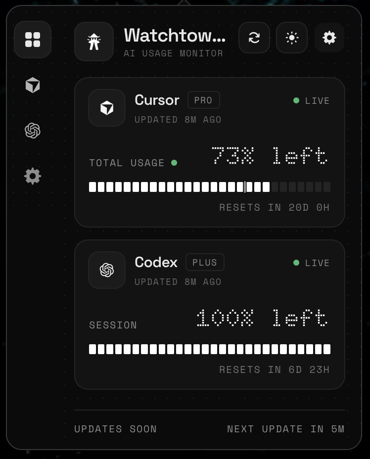

# Watchtower

Opinionated OpenUsage for Codex, Cursor, Claude, OpenCode, Gemini, Kiro, Kimi, Devin, Grok Bot, and Muse Code.

## Develop

See [docs/local-development.md](docs/local-development.md) for prerequisites, `bun run tauri dev`, and tests on macOS.

<p align="center">
  
</p>

## Install

```sh
brew install --cask keshav-k3/tap/watchtower
xattr -dr com.apple.quarantine /Applications/watchtower.app
```

## Mac Widget

On macOS Sonoma and later, Watchtower can show the same usage in Notification Center and on the desktop. The widget is built into the app on a Mac. Setup is in [docs/widget.md](docs/widget.md).

## Upgrade

```sh
brew upgrade --cask keshav-k3/tap/watchtower
```
